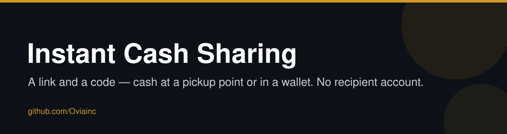

# Instant Cash Sharing — CashLink prototype

Send money to anyone, on any device: the recipient gets a **link and
a short code**, chooses **cash at a pickup point** or **a wallet**,
and collects. No recipient account, no login, no app to install.

## The legal minimum — stated plainly

"No KYC, anywhere, ever" cannot be built: anti-money-laundering law
(FINTRAC in Canada, FinCEN in the US, equivalents elsewhere) obliges
the operator to identify senders, and cash pickup points to check the
receiver's ID against the transfer. Any service promising zero ID is
either illegal or not actually moving money.

What **can** be built — and what this prototype builds — is the
lightest lawful shape:

- **Recipient side:** link + code only. The one ID moment happens at
  payout: ID shown once at the pickup point, or the wallet provider's
  own check. No account is ever created for the recipient.
- **Sender side:** identification handled by the operator/provider,
  as the law requires — outside this core.
- **Per-transfer cap under CAD 1,000**, enforced in code. Splitting a
  larger send into pieces to stay under a threshold is structuring;
  the core names it and refuses amounts over the cap by design.
- **One claim only.** Codes are stored hashed, shown once at
  creation. Transfers expire after 72 hours.

## What is in the prototype

- `cashlink/core.py` — the transfer state machine
  (created → claimable → claimed / expired / cancelled), cap
  enforcement, hashed claim codes, JSON-file store
- `cashlink/__main__.py` — CLI demo of the full flow
- `tests/` — cap refusal, wrong-code refusal, double-claim refusal,
  code-never-stored-in-clear, full claim flow

```bash
python -m cashlink create --sender "Sender" --recipient "Receiver" \
    --amount 250 --method cash_pickup
python -m cashlink claim --id CL-XXXXXXXX --code XXXXXXXXXX \
    --payout-ref "Pickup point 4421 — ID shown"
python -m pytest tests/ -q   # 4 passed
```

## Status and the open decision

Local prototype only: **no real money moves and no provider is
connected.** The route decision stays open, exactly as recorded:
**partner network** (existing licensed pickup networks, fastest to
launch) versus **own MSB licence + own prepaid card** (more control,
much heavier). Nothing launches until that decision is made and a
licensed route carries the transfers.

Part of the OVIA payments workstream.

Licensed under the Apache License 2.0.
